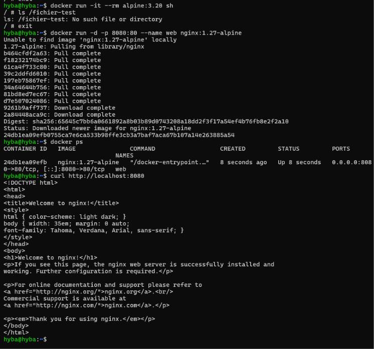
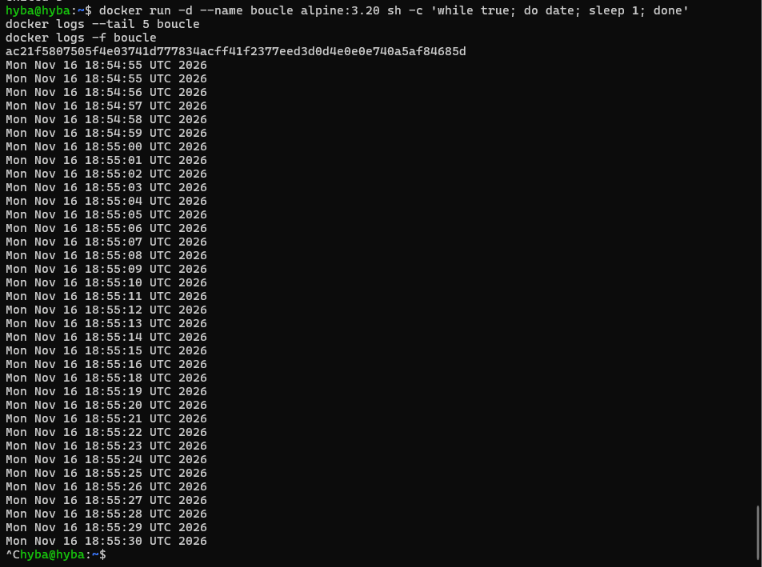
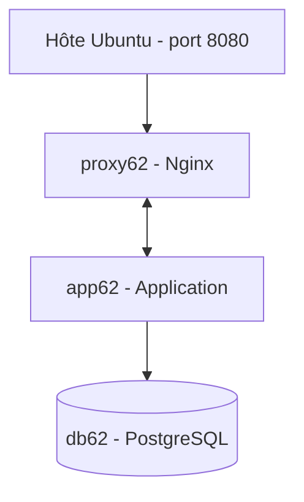

# Docker Training Labs – Partie 1

## Présentation

Ce dépôt contient les travaux pratiques réalisés dans le cadre de la formation Docker Training Labs – Partie 1.

Les manipulations ont été effectuées sur **Ubuntu Server**. Chaque laboratoire contient les captures d'écran illustrant les différentes étapes et les résultats obtenus.

## Liste des laboratoires

### Lab 1.1 – Installation et découverte de Docker

&#x20; 

&#x20; 

&#x20; 

### Lab 1.2 – Premiers pas avec les conteneurs

&#x20; 

&#x20; 

&#x20; 

&#x20; 

&#x20; 

&#x20; 

### Lab 2.1 – Cycle de vie des conteneurs

&#x20; 

&#x20; 

&#x20; 

&#x20; 

&#x20; 

&#x20; 

&#x20; 

&#x20; 

&#x20; 

&#x20; 

&#x20; 

&#x20; 

&#x20; 

&#x20; 

&#x20; 

&#x20; 

### Lab 3.1 – Création et gestion des images Docker

&#x20; 

&#x20; 

&#x20; 

&#x20; 

### Lab 3.2 – Optimisation du processus de build

&#x20; 

&#x20; 

&#x20; 

&#x20; 

&#x20; 

### Lab 4.1 – Docker Hub et publication des images

&#x20; 

&#x20; 

&#x20; 

### Lab 4.2 – Docker Registry privé

&#x20; 

&#x20; 

---

## Lab 5.1 – Stockage et persistance des données

### Objectif

Comprendre les mécanismes de stockage Docker : couche writable, volumes, bind mounts et tmpfs.

### Réalisations

- Stockage dans la couche writable du conteneur : les données disparaissent après suppression.
- Utilisation du volume nommé `lab51-data` : les données persistent.
- Bind mount en lecture seule (`:ro`) avec Nginx.
- Montage `tmpfs` pour des données temporaires en mémoire, vérifié avec `df -h`.

### Captures d'écran

---

## Lab 5.2 – Sauvegarde et restauration des volumes Docker

### Objectif

Sauvegarder et restaurer les données persistantes d'une base PostgreSQL.

### Réalisations

- Création du volume `lab52-pgdata` et du conteneur `lab52-db`.
- Création de la table `notes` avec trois étudiants : Ahmed (15.50), Sarra (17.00) et Youssef (13.75).
- Sauvegarde du volume dans `lab 5.2/pgdata.tar.gz`.
- Restauration dans le volume `lab52-restore-pgdata`.
- Vérification des trois enregistrements dans `lab52-restore-db`.

[Archive PostgreSQL](lab%205.2/pgdata.tar.gz)

### Captures d'écran

---

## Lab 6.1 – Réseaux Docker et résolution DNS

### Objectif

Comprendre les réseaux Docker, la communication entre conteneurs et l'isolation réseau.

### Réalisations

- Inspection des réseaux `bridge`, `host` et `none`.
- Tests de communication sur le réseau bridge par défaut.
- Création du réseau personnalisé `reseau-tp` et vérification de la résolution DNS.
- Déploiement de Nginx accessible sur le port 8080.
- Connexion et déconnexion d'un conteneur à un réseau, utilisation d'un alias.
- Test d'un conteneur avec `--network none`.

### Captures d'écran

### Conclusion

Résolution DNS sur un réseau personnalisé, communication entre réseaux connectés et isolation réseau démontrées.

---

## Lab 6.2 – Architecture réseau à trois niveaux

### Objectif

Mettre en place un proxy, une application et une base de données sur deux réseaux séparés.

### Architecture

- **Proxy :** Nginx, conteneur `proxy62`, réseau `frontend`.
- **Application :** `app62`, connecté à `frontend` et `backend`.
- **Base de données :** PostgreSQL, `db62`, réseau `backend` (`--internal`).
- **Volume :** `pgdata-reseau-62`.
- Seul le proxy publie `127.0.0.1:8080 -> 80/tcp`.

### Tests effectués

1. `curl http://localhost:8080` : réussi.
2. `proxy62` vers `app62` : réussi.
3. Résolution de `db62` depuis `proxy62` : impossible, comme attendu.
4. `app62` vers `db62` avec `pg_isready` : réussi.
5. Résolution de `proxy62` depuis `db62` : impossible, comme attendu.
6. Accès Internet depuis `db62` : impossible.
7. Accès Internet depuis `proxy62` : réussi.

### Schéma

### Captures d'écran

### Conclusion

Le proxy est accessible depuis l'hôte, l'application parle à la base via `backend`, et la base reste isolée du frontend et d'Internet.

---

## Environnement de travail

- **Système :** Ubuntu Server
- **Technologie :** Docker
- **Terminal :** Bash
- **Versions :** Git et GitHub

## Auteur

Réalisé dans le cadre des travaux pratiques Docker Training Labs – Partie 1.
