\# Docker Training Labs – Partie 1

\## Présentation

Ce dépôt contient les travaux pratiques réalisés dans le cadre de la formation Docker Training Labs – Partie 1.

Les manipulations ont été effectuées sur \*\*Ubuntu Server\*\*. Chaque laboratoire contient les captures d'écran illustrant les différentes étapes et les résultats obtenus.

\## Liste des laboratoires

\### Lab 1.1 – Installation et découverte de Docker

&#x20; 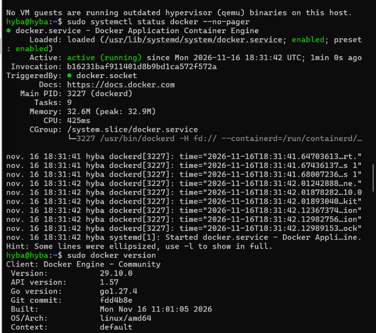

&#x20; 

&#x20; 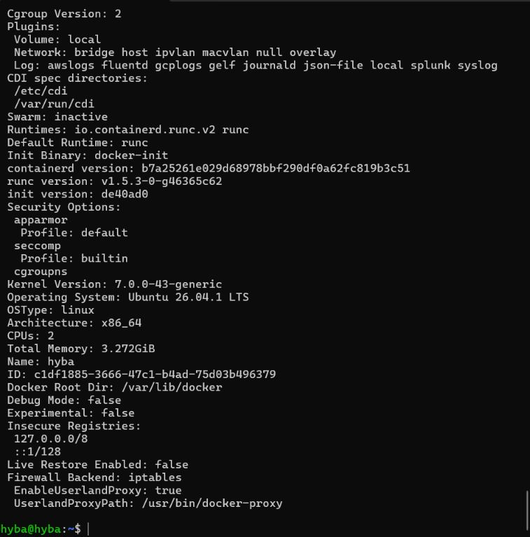

\### Lab 1.2 – Premiers pas avec les conteneurs

&#x20; 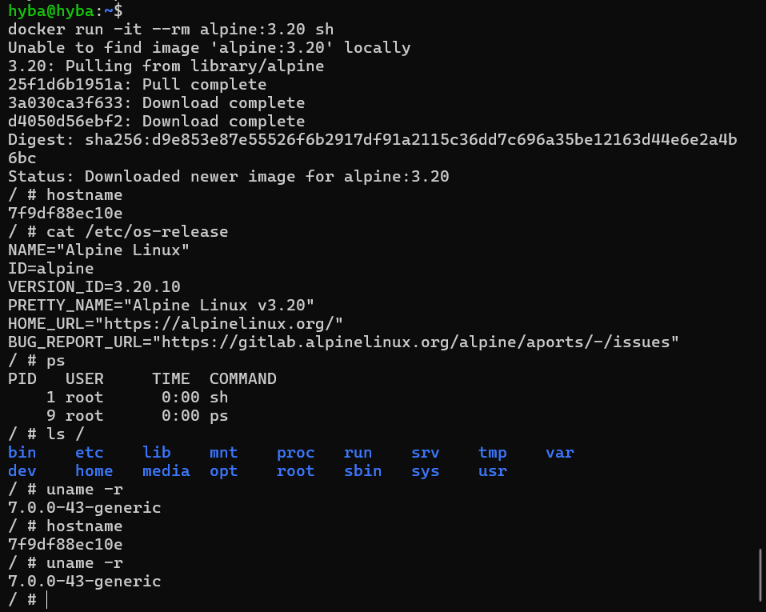

&#x20; 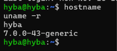

&#x20; 

&#x20; 

&#x20; 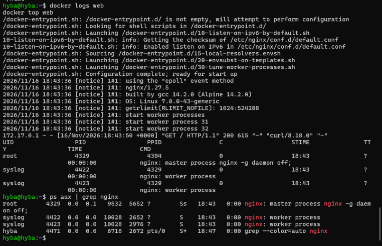

&#x20; 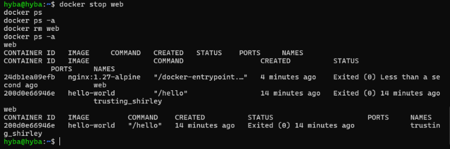

\### Lab 2.1 – Cycle de vie des conteneurs

&#x20; 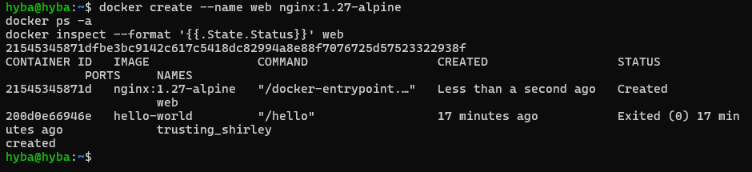

&#x20; 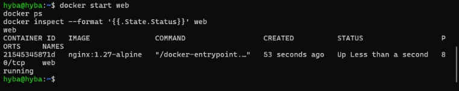

&#x20; 

&#x20; 

&#x20; 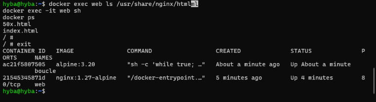

&#x20; 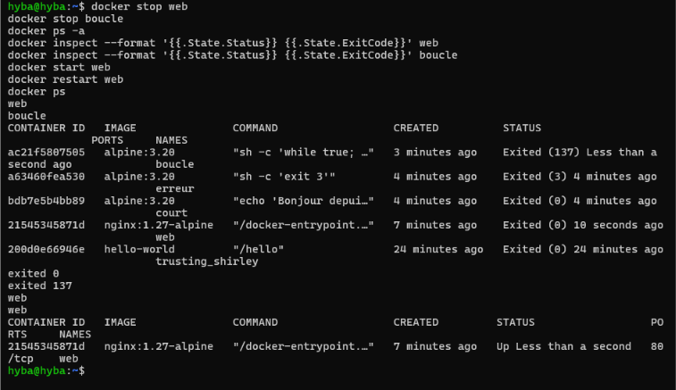

&#x20; 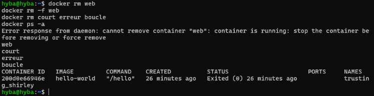

&#x20; 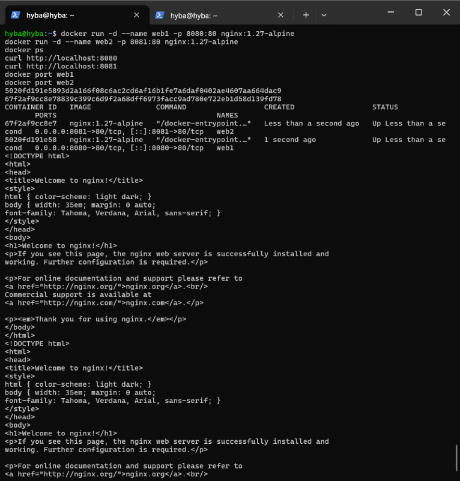

&#x20; 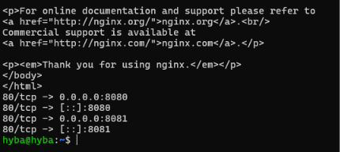

&#x20; 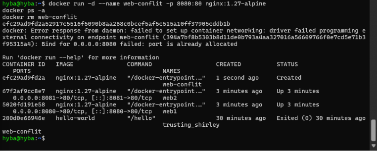

&#x20; 

&#x20; 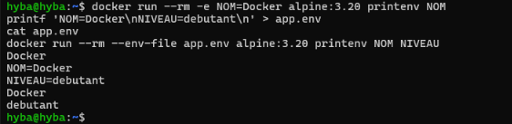

&#x20; 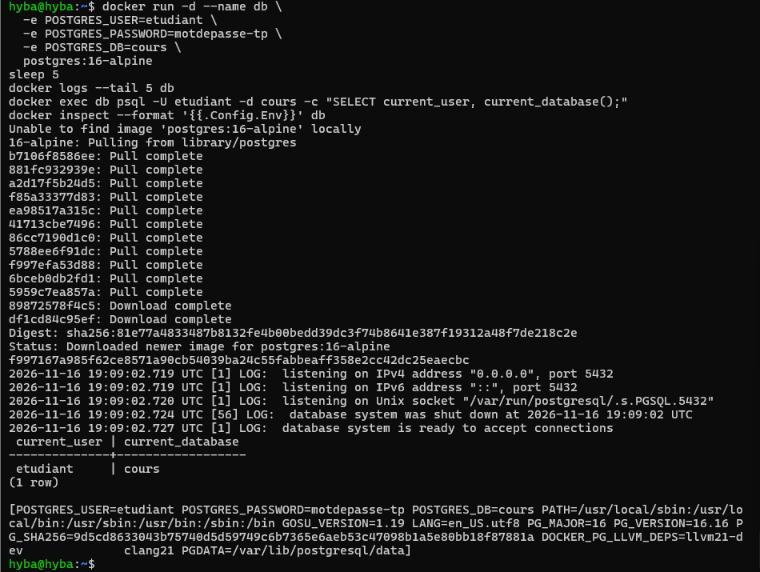

&#x20; 

&#x20; 

&#x20; 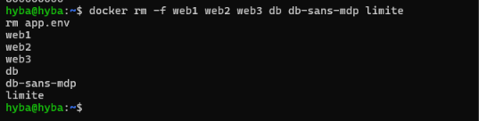

\### Lab 3.1 – Création et gestion des images Docker

&#x20; 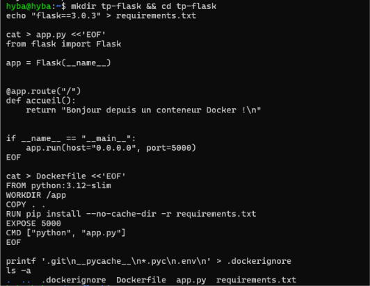

&#x20; 

&#x20; 

&#x20; 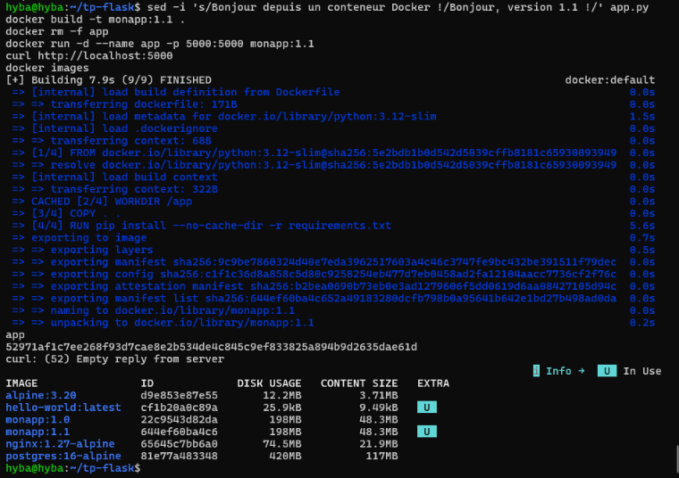

\### Lab 3.2 – Optimisation du processus de build

&#x20; 

&#x20; 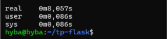

&#x20; 

&#x20; 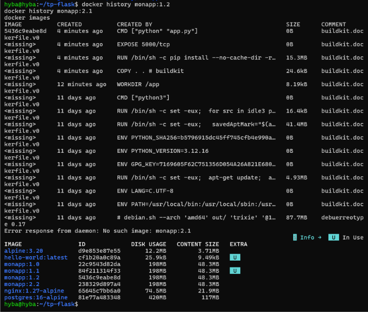

&#x20; 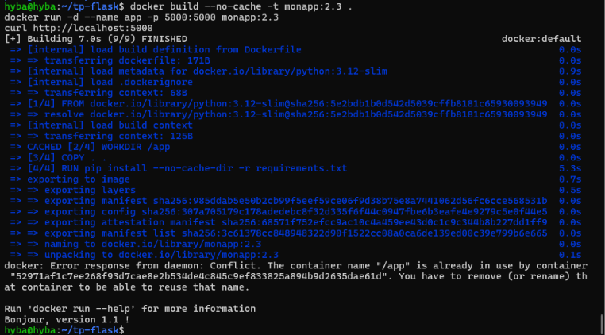

\### Lab 4.1 – Docker Hub et publication des images

&#x20; 

&#x20; 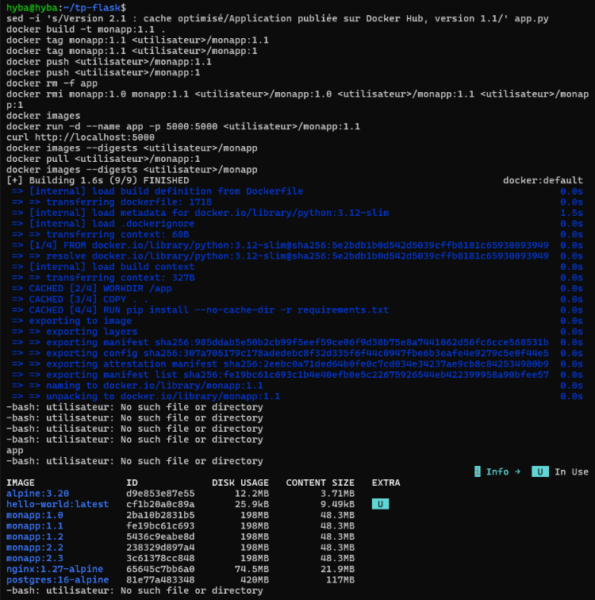

&#x20; 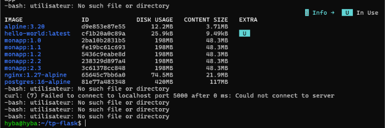

\### Lab 4.2 – Docker Registry privé

&#x20; 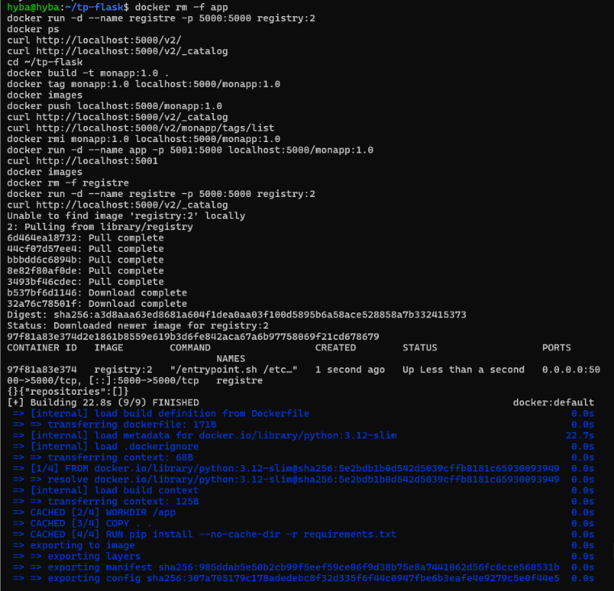

&#x20; 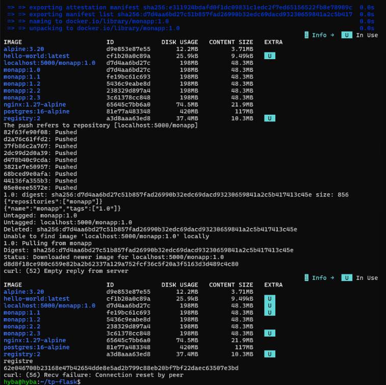

\## Environnement de travail

\- \*\*Système d'exploitation :\*\* Ubuntu Server

\- \*\*Technologie :\*\* Docker

\- \*\*Terminal :\*\* Bash

\- \*\*Gestion des versions :\*\* Git et GitHub

\## Auteur

Réalisé dans le cadre des travaux pratiques Docker Training Labs – Partie 1.

