\# Docker Training Labs – Partie 1

\## Présentation

Ce dépôt contient les travaux pratiques réalisés dans le cadre de la formation Docker Training Labs – Partie 1.

Les manipulations ont été effectuées sur \*\*Ubuntu Server\*\*. Chaque laboratoire contient les captures d'écran illustrant les différentes étapes et les résultats obtenus.

\## Liste des laboratoires

\### Lab 1.1 – Installation et découverte de Docker

&#x20; 

&#x20; 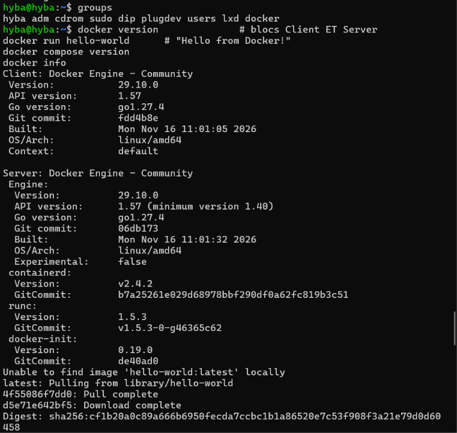

&#x20; 

\### Lab 1.2 – Premiers pas avec les conteneurs

&#x20; 

&#x20; 

&#x20; 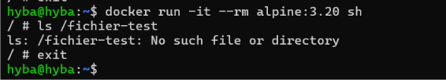

&#x20; 

&#x20; 

&#x20; 

\### Lab 2.1 – Cycle de vie des conteneurs

&#x20; 

&#x20; 

&#x20; 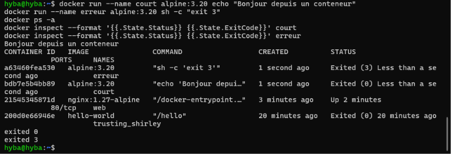

&#x20; 

&#x20; 

&#x20; 

&#x20; 

&#x20; 

&#x20; 

&#x20; 

&#x20; 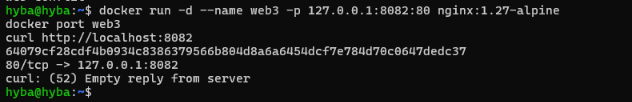

&#x20; 

&#x20; 

&#x20; 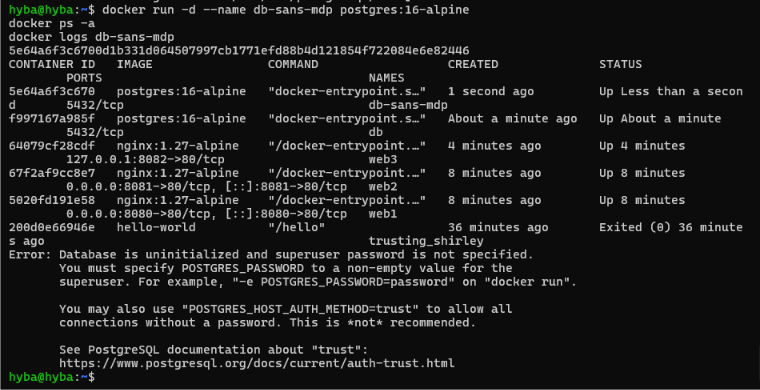

&#x20; 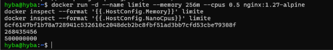

&#x20; 

\### Lab 3.1 – Création et gestion des images Docker

&#x20; 

&#x20; 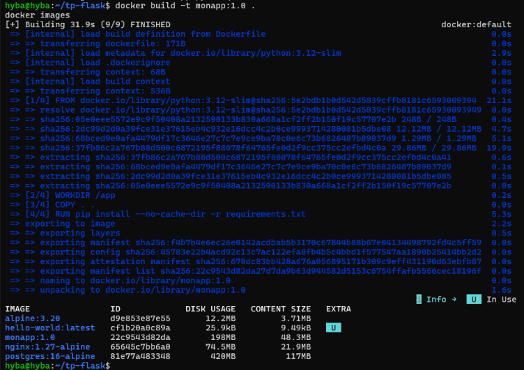

&#x20; 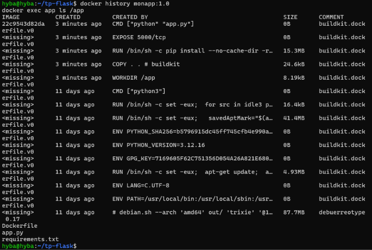

&#x20; 

\### Lab 3.2 – Optimisation du processus de build

&#x20; 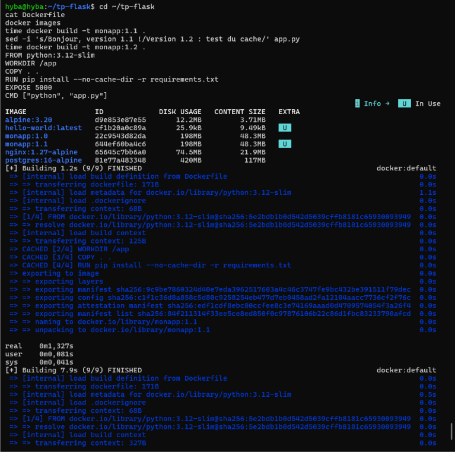

&#x20; 

&#x20; 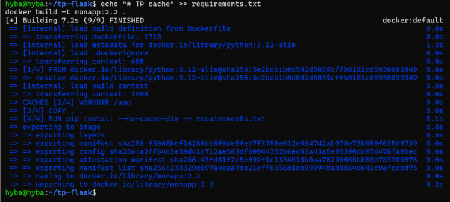

&#x20; 

&#x20; 

\### Lab 4.1 – Docker Hub et publication des images

&#x20; 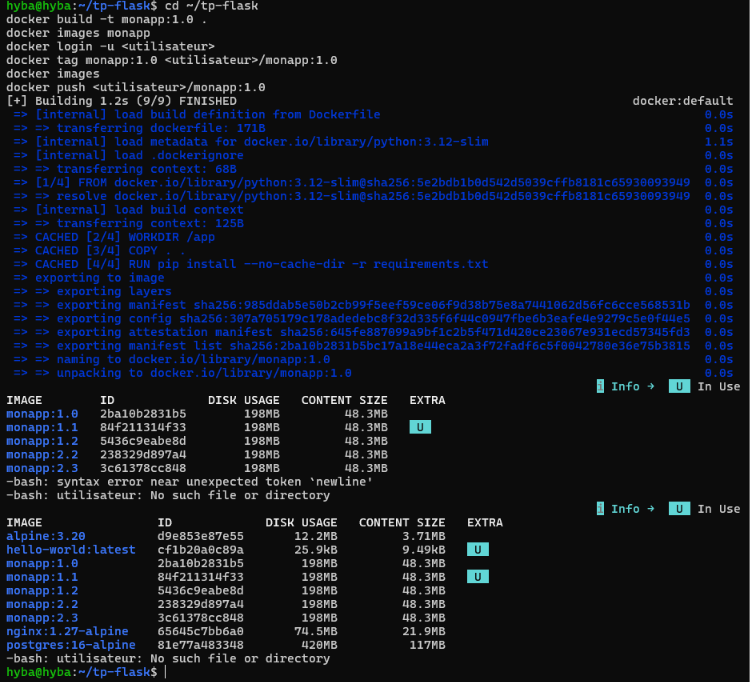

&#x20; 

&#x20; 

\### Lab 4.2 – Docker Registry privé

&#x20; 

&#x20; 

---

## Lab 5.1 – Stockage et persistance des données

### Objectif
Comprendre les différents mécanismes de stockage Docker.

### Réalisations
- Stockage dans la couche writable du conteneur et vérification de la perte des données après suppression.
- Utilisation d'un volume nommé `lab51-data` pour conserver les données.
- Utilisation d'un bind mount en lecture seule avec Nginx.
- Utilisation de `tmpfs` pour stocker des données temporaires en mémoire.

### Captures d'écran
Les 17 captures du laboratoire sont disponibles dans `lab 5.1/captures/`.

---

## Lab 5.2 – Sauvegarde et restauration des volumes Docker

### Objectif
Sauvegarder et restaurer les données persistantes d'une base PostgreSQL.

### Réalisations
- Création du volume `lab52-pgdata` et du conteneur `lab52-db`.
- Création de la table `notes` avec trois étudiants : Ahmed (15.50), Sarra (17.00) et Youssef (13.75).
- Sauvegarde du volume dans `lab 5.2/pgdata.tar.gz`.
- Restauration dans le volume `lab52-restore-pgdata`.
- Vérification des trois enregistrements dans le conteneur `lab52-restore-db`.

### Fichier de sauvegarde
[Archive PostgreSQL](lab%205.2/pgdata.tar.gz)

---

## Lab 6.1 – Réseaux Docker et résolution DNS

### Objectif
Comprendre les réseaux Docker, la communication entre conteneurs et l'isolation réseau.

### Réalisations
- Inspection des réseaux `bridge`, `host` et `none`.
- Tests de communication sur le réseau bridge par défaut.
- Création du réseau personnalisé `reseau-tp`.
- Vérification de la résolution DNS entre conteneurs.
- Déploiement de Nginx accessible sur le port 8080.
- Connexion et déconnexion d'un conteneur à un réseau.
- Utilisation d'un alias réseau.
- Test d'un conteneur avec `--network none`.

### Conclusion
Les tests ont démontré la résolution DNS sur un réseau personnalisé, la communication entre réseaux connectés et l'isolation réseau.

---

## Lab 6.2 – Architecture réseau à trois niveaux

### Objectif
Mettre en place une architecture avec un proxy, une application et une base de données sur deux réseaux séparés.

### Architecture
- **Proxy :** Nginx, conteneur `proxy62`, réseau `frontend`.
- **Application :** conteneur `app62`, connecté à `frontend` et `backend`.
- **Base de données :** PostgreSQL, conteneur `db62`, réseau `backend`.
- **Réseau backend :** réseau interne créé avec `--internal`.
- **Volume :** `pgdata-reseau-62`.

### Publication des ports
Seul le proxy publie `127.0.0.1:8080 -> 80/tcp`. Les conteneurs `app62` et `db62` ne publient aucun port sur l'hôte.

### Tests effectués
1. Accès à Nginx avec `curl http://localhost:8080` : réussi.
2. Communication entre `proxy62` et `app62` : réussie.
3. Résolution de `db62` depuis `proxy62` : impossible, comme attendu.
4. Connexion PostgreSQL de `app62` vers `db62` avec `pg_isready` : réussie.
5. Résolution de `proxy62` depuis `db62` : impossible, comme attendu.
6. Accès Internet depuis `db62` : impossible.
7. Accès Internet depuis `proxy62` : réussi.

### Schéma de l'architecture

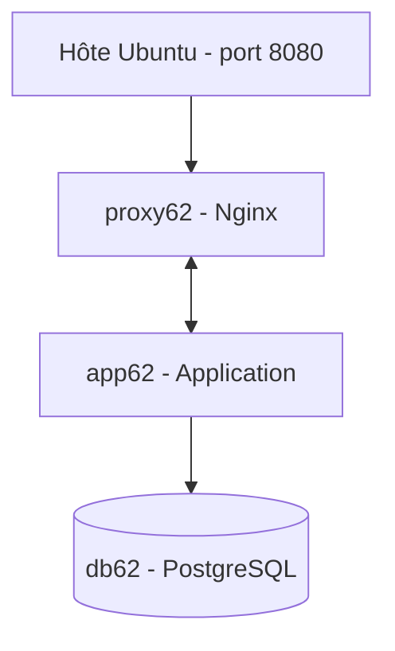

### Conclusion
Cette architecture démontre la segmentation des réseaux Docker. Le proxy est accessible depuis l'hôte, l'application communique avec la base de données via le réseau backend, et la base de données reste isolée du réseau frontend et d'Internet.

\## Environnement de travail

\- \*\*Système d'exploitation :\*\* Ubuntu Server

\- \*\*Technologie :\*\* Docker

\- \*\*Terminal :\*\* Bash

\- \*\*Gestion des versions :\*\* Git et GitHub

\## Auteur

Réalisé dans le cadre des travaux pratiques Docker Training Labs – Partie 1.

